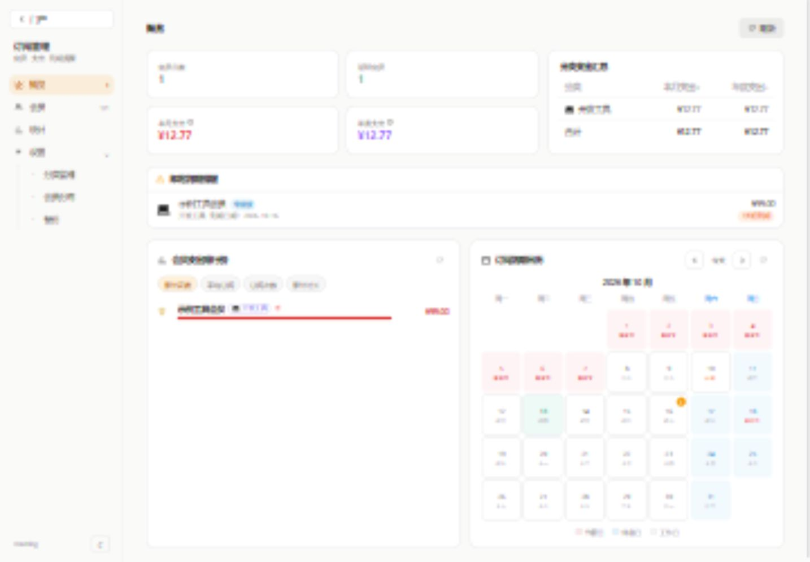
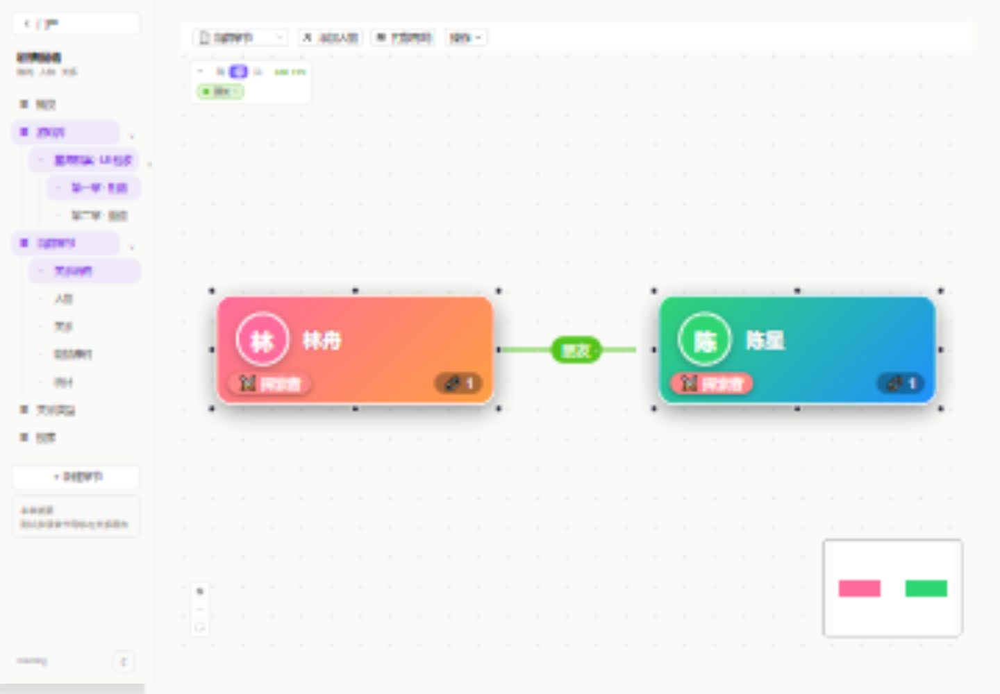
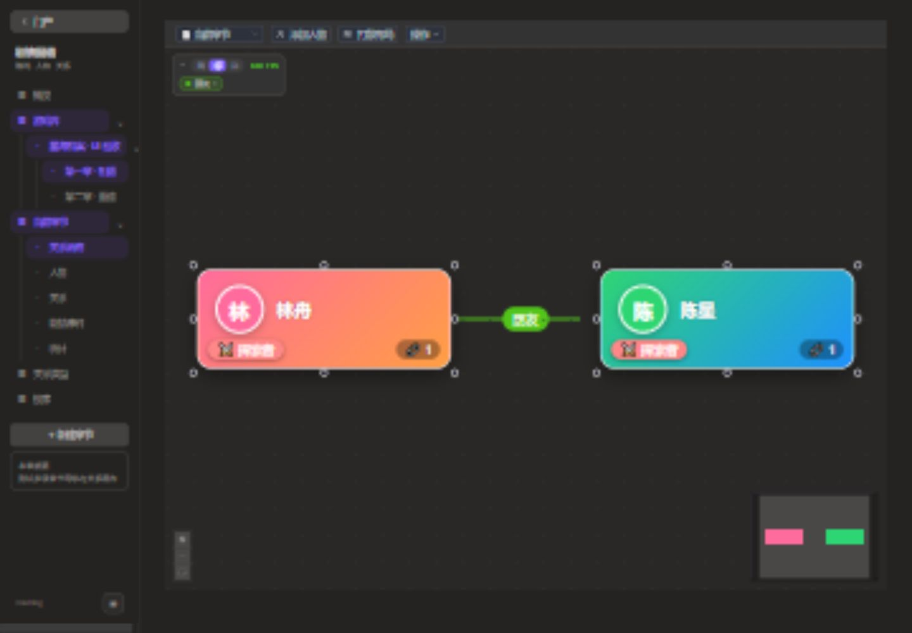
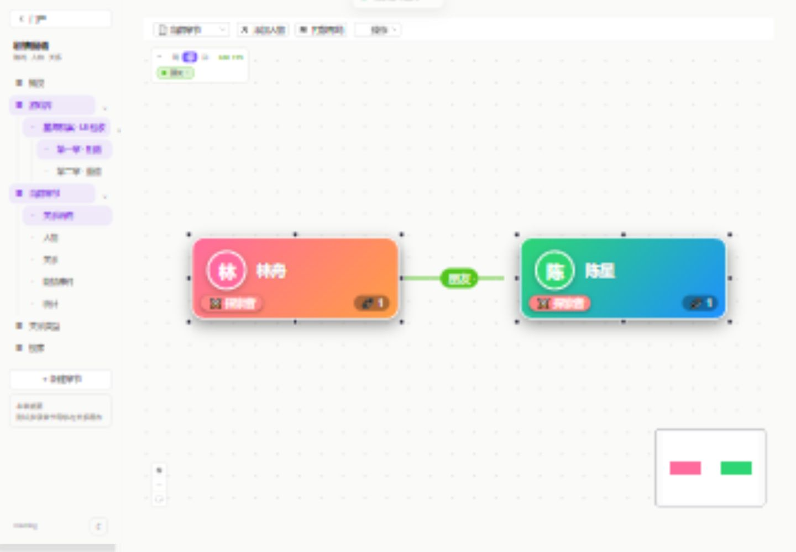
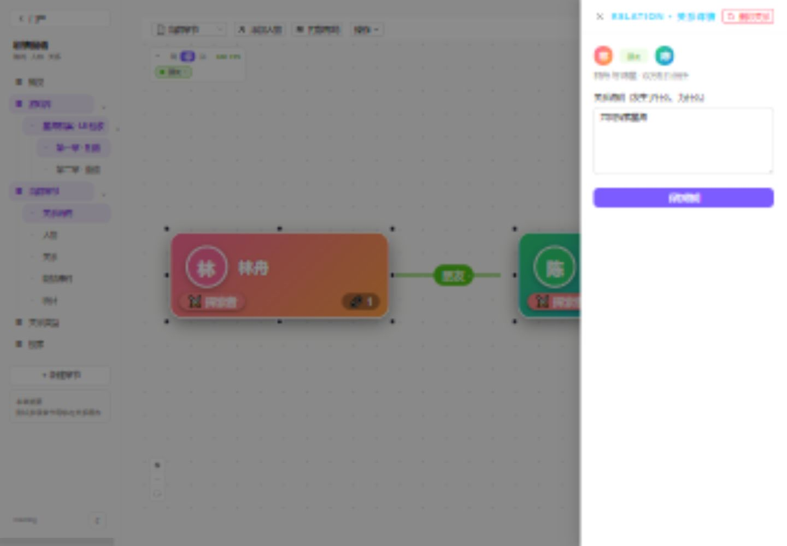
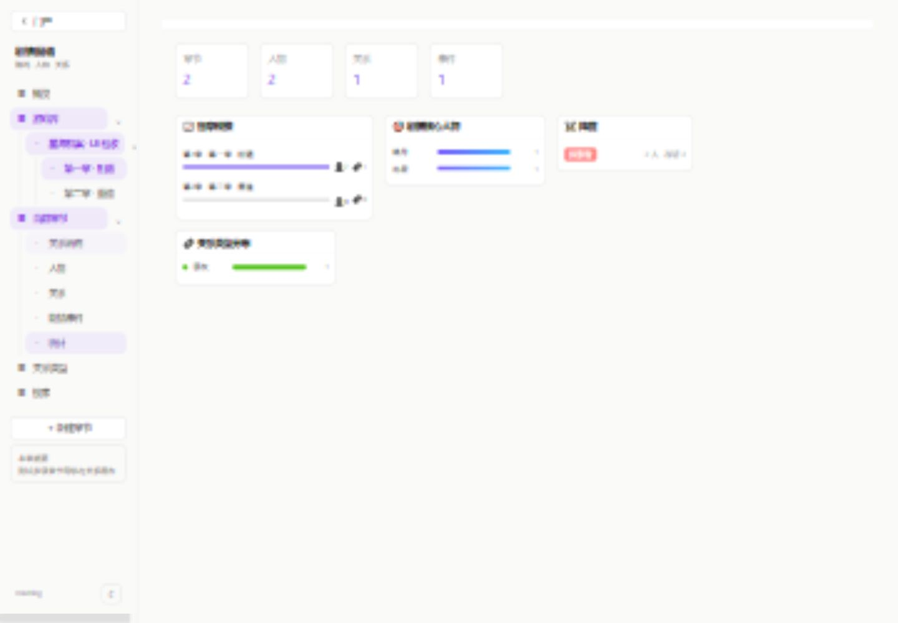
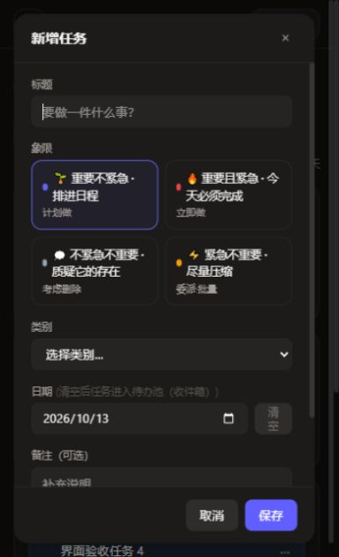

# 公共导航、画布与前端优化验收（2026-10-13）

本次改造将业务模块接入同一个 `ModuleShell`：桌面左侧栏宽 220px，支持多级菜单；正文统一最大宽度 1700px 和响应式留白。移动端使用同一菜单抽屉，支持遮罩关闭、Escape、焦点约束及恢复，切回桌面自动关闭。门户、登录、日记公开分享保持独立页面。

## 验收环境与方法

- 使用本地 IAB 浏览器，桌面 1440px、移动端 390px，并检查 390×640 的短屏弹窗。
- 使用独立 SQLite 测试实例与样例数据（`.ui-qa/data`），不使用生产数据完成新增、编辑、删除或账号操作。
- 检查实际渲染截图、可访问性树和 DOM 几何尺寸；检查明暗主题、导航、正文边界、表格内部滚动、弹层高度和条件表单。
- 截图原件与逐状态检查记录留在被 Git 忽略的 `.ui-qa/`；精选证明图保存在 `docs/ui-qa-assets/`。

## 页面与交互覆盖

| 模块 | 已走查页面与交互 |
|---|---|
| 订阅 | 概览、会员表格/卡片/详情、订阅表格与时间线、统计、分类/分摊/备份设置；会员、分类、订阅表单、到期日弹层 |
| Todo | 今日四象限、待办池三个子页、日历多视图、回顾、统计、设置；规律生活五个子页、四种计划规则表单、打卡、任务编辑和迁移相关弹层 |
| 刷题 | 题库、详情、复习空态、统计；题目表单、标签与筛选菜单、移动端长表单 |
| 日记 | 时间线、日历、热力图、统计、回收站；编辑与预览、模板及分册菜单、分享弹窗、公开分享样例和失效态 |
| 博客 | 知识库、文章、新建、编辑、管理；知识库选择与创建、树菜单、删除确认取消、图片预览；Markdown 表格、KaTeX 与 Mermaid 渲染 |
| 密码库 | 初始化样例、锁定/恢复、解锁后八个视图；分类/标签、条目详情与编辑、生成器、命令面板、设置四页及移动端布局 |
| 密码服务 | 项目列表/详情、新建项目、新建类型、添加用户；移动端布局及样例轮换密码展示 |
| 日志 | 有数据的列表、详情、上下文、零跨度 trace、模式分组；系统/级别/日期筛选、保存查询、导出菜单、告警配置及移动端 |
| API Hub | 六个主视图；上游/API/令牌/限流规则表单、密钥与分组、探测失败反馈、条件限流字段 |
| Steam 挂机 | 登录表单、离线样例账号卡、游戏选择、日志、设置；桌面与移动端 |
| Gamemap | 概览、游戏库、关系类型、搜索结果、看板/人物/关系/事件/统计五种工作区；章节、人物、关系详情、绑定、照片图鉴/编辑/预览、差异与批量工具、范围菜单、导出反馈、无效游戏错误态 |
| 系统配置/配置中心 | 配置卡片、namespace 与 KV 页面、相应表单和菜单，以及明暗/移动端布局 |

上述覆盖包括各模块主要视图的明暗主题与移动端；并非每个字段取值的所有组合。真实 Steam 登录/验证码、浏览器天气授权、外部凭据验证、真实密钥重置和破坏性业务操作未执行。日记公开分享与密码库初始化使用隔离样例响应。

## 发现并修复的问题

- Gamemap 显式设置工作区高度，失败请求提供重试；ReactFlow 背景改为透明，恢复被节点层背景遮挡的自绘关系线。明暗主题下均能看到关系线，点击可打开关系详情。
- Gamemap 画布、工具栏、HUD、事件和统计卡片使用明暗变量；筛选工具栏允许换行，人物/关系表格内部滚动。搜索和概览移除已弃用的 Ant List 用法。
- Todo 待办池与规律生活子页接入多级侧栏；修复生活计划星期按钮文字为空的问题。
- Todo、订阅、日志弹窗限定视口高度，内容内部滚动；短屏保留标题和操作区。订阅详情日期字段移动端改为两列。
- 日志移动端摘要重新分行，避免正文被挤出；上下文按日志 ID 去重，零跨度 trace 避免除零。
- 密码库设置标签允许换行并固定关闭按钮；Argon2 内存单位标注从 MB 更正为 KiB，加密算法未改。
- 博客移动端编辑器与预览纵向排列，正文入口回到知识库；删除各模块重复的顶栏、主题按钮和全局内边距。
- PNG 导出改为 Blob 并展示生成状态。已实际看到“看板已导出为 PNG”成功提示；浏览器工具未返回可读取的下载文件，因此未进行导出 PNG 的像素验收。

## 性能结果

| 项目 | 改造前 | 改造后 | 测量范围 |
|---|---:|---:|---|
| 主入口 JS gzip | 73.89 KB | 63.62 KB | Vite 构建 chunk |
| TodoPage gzip | 25.36 KB | 1.60 KB | 各视图改为独立懒加载 chunk |
| SubsPage gzip | 122.34 KB | 16.29 KB | 到期日历独立 chunk，约 103.95 KB gzip |
| 关系计数与聚焦邻居 | 282.47 ms | 0.823 ms | 2000 节点、12000 关系，5 次算法基准中位数；结果一致 |

chunk 大小不等于整个页面总下载量；订阅概览显示到期日历时仍加载日历 chunk。算法基准不是浏览器帧率或端到端渲染耗时。

另外实施了日记搜索防抖与旧请求结果保护、按视图跳过时间线请求、博客预览延后计算、日志/Steam 轮询防重叠与隐藏页面暂停；Steam 元数据使用 60 秒缓存。未新增依赖。

## 构建与回归

- 最终 `npm run build` 成功；大型 Markdown/图表相关 chunk 仍有 Vite 的 500 KB 提醒。
- 新公共组件、独立日历及 Gamemap Toolbar/tables 的定向 ESLint 检查通过。
- 全仓 ESLint 仍有既有问题（此次检查记录为 239 errors、20 warnings）；本次未将全仓 lint 描述为通过。
- 后端全量回归首次为 466 passed、1 个内嵌 PostgreSQL 启动环境错误；该数据库往返用例在允许启动的环境单独复跑通过。合计 467 个用例通过。
- `git diff --check` 通过。API、数据库模型及密码算法未改。

## 截图

公共侧栏和内容画布：

Gamemap 明暗画布与关系线：

PNG 生成成功提示（下载文件未取得，见上文边界）：

关系点击详情、浅色统计和移动端短屏弹窗：

